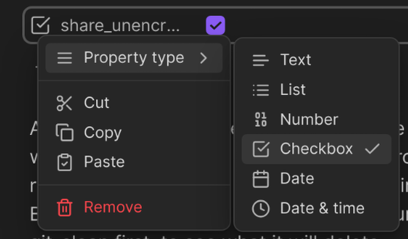

# Frontmatter properties

Share Note reads and writes a handful of properties in a note's frontmatter. They all share a prefix, `share` by default, which you can change with the [Frontmatter property prefix](../settings#frontmatter-property-prefix) setting. If your prefix is `pub`, read `pub_link` wherever this page says `share_link`, and so on.

## Written by the plugin

| Property | What it holds |
|---|---|
| `share_link` | The address of the shared page, including the decryption key for encrypted notes. Its presence is how the plugin knows a note is shared: keep it to update or delete the share. |
| `share_updated` | When the note was last shared. |

Both are removed again when you delete the shared note.

## Set by you

Add these yourself to change how a single note is shared. Use the **Checkbox** type where shown; ticked means on.

| Property | Type | Effect |
|---|---|---|
| `share_encrypted` | Checkbox | Encrypt this note even if [Share as encrypted by default](../settings#share-as-encrypted-by-default) is off. |
| `share_unencrypted` | Checkbox | Share this note unencrypted even if the default is encrypted. If both are ticked, `share_encrypted` wins. |
| `share_expires` | Text | Delete the shared note after this long, for example `7 days`. Overrides the default expiry. See [Self-deleting notes](./self-deleting-notes). |
| `share_source` | Checkbox | Include (ticked) or leave out (unticked) the Markdown source for this note, overriding the [Include Markdown source](../settings#include-markdown-source-in-shared-notes) setting. See [Letting readers import your note](./importing-shared-notes). |
| `share_title` | Text | The title of the shared page, used when [Note title source](../settings#note-title-source) is set to **Frontmatter property**. |

## Custom slugs (self-hosted servers)

| Property | Type | Effect |
|---|---|---|
| `share_slug` | Text, set by you or the custom slug prompt | Choose the URL before first sharing, with [Enable custom slugs](../settings#enable-custom-slugs) turned on. If missing or blank on a new share, the plugin prompts for a custom slug or a generated link. |
| `share_id` | Text, written by the plugin | Identifies a particular custom-slug publication. Keep it with `share_link` to update or delete safely. Removed on successful deletion. |

These properties use your configured prefix too, for example `pub_slug` and
`pub_id`. Active slugs cannot change. Expiry or deletion releases the name for
reuse; the identifier prevents an old note from modifying its replacement.
